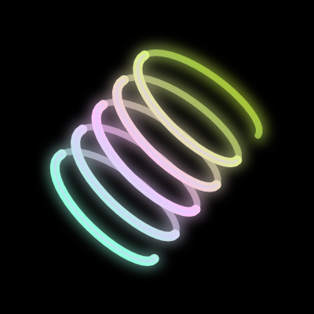
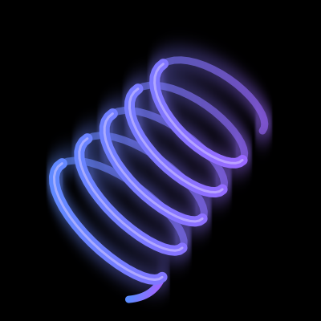

# ⚡ Раздел: Катушки (Coils)

Добро пожаловать в архив катушек!

  <a href="summoncoil.html" class="item-card">
    
    <h3>Катушка призыва</h3>
  </a>

  <a href="fissioncoil.html" class="item-card">
    
    <h3>Катушка расщепления</h3>
  </a>

  <a href="flexcoil.html" class="item-card">
    
    <h3>Флекс-катушка</h3>
  </a>

  <a href="zowkycoil.html" class="item-card">
    
    <h3>Зовки-катушка</h3>
  </a>

  <a href="guardiancoil.html" class="item-card">
    
    <h3>Защитная катушка</h3>
  </a>

 

  <a href="index.html" class="lang-btn"> На Главную</a>

