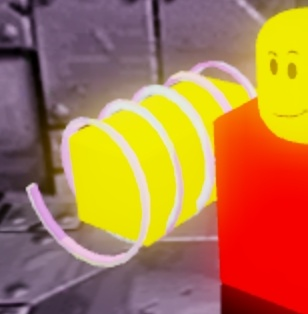

# Катушка призыва

<!-- Блок генератора в фиолетовой рамке -->

    <h3 style="color: #ffffff; text-align: center; text-shadow: 0 0 15px #a066ff, 0 0 5px rgba(138, 43, 226, 0.8); margin-bottom: 20px;">
        🎨 База цветов кубиков
    </h3>
    

