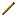

# ⚡ Раздел: Палочки (Wands)

  <a href="horrificwand.html" class="item-card">
    
    <h3>Ужасная палочка</h3>
  </a>

  

    
    <h3>Пока пусто</h3>
  

 

  <a href="index.html" class="lang-btn"> На Главную</a>

